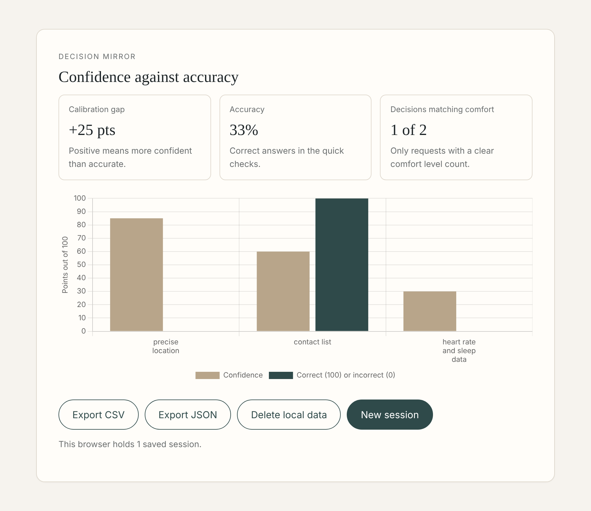
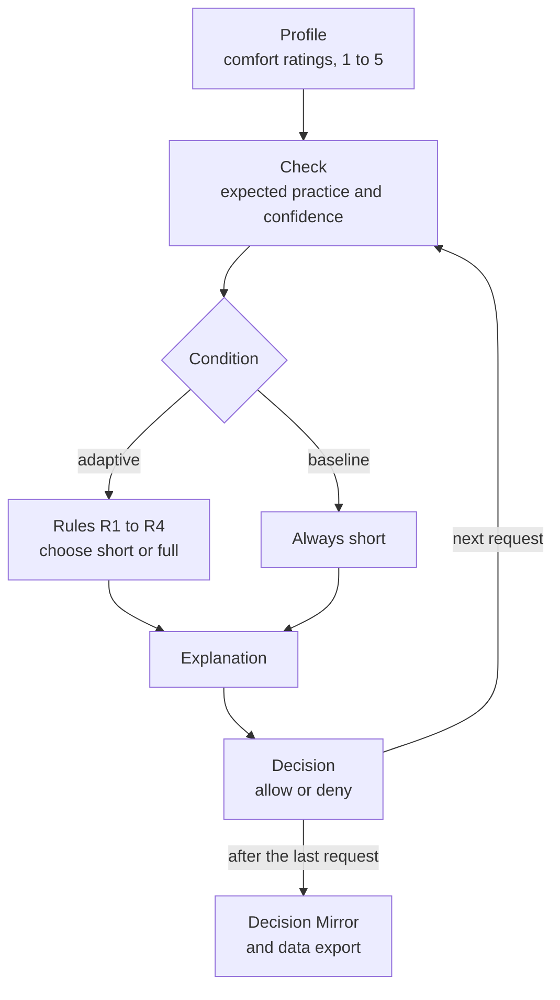
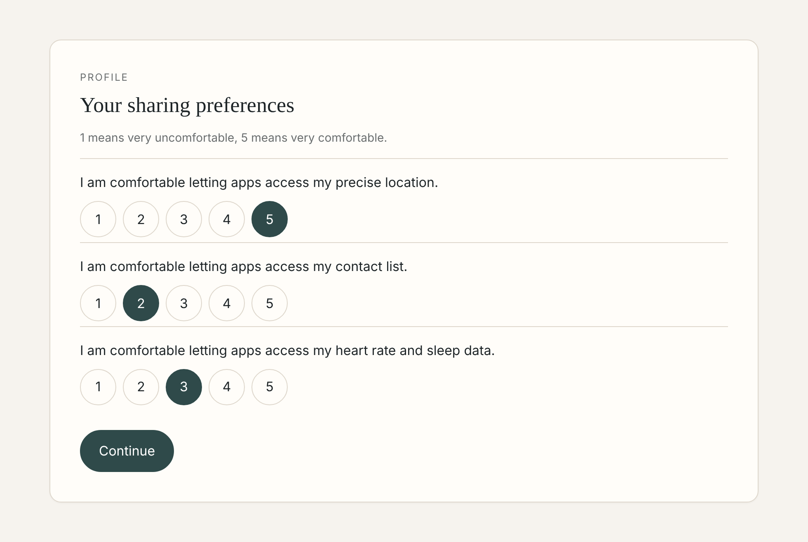

# The Trust Gap

**Adaptive privacy explanations for informed decisions and calibrated trust**

Personal project · HCI research prototype · In development

   

The Trust Gap is an interactive research prototype about privacy decisions. It asks people what they expect an app to do with their data and how sure they are, then uses a small set of transparent rules to decide how much to explain before they choose whether to share. The distance between confidence and accuracy is the "trust gap". The research question is whether adaptive explanations narrow that gap and lead to choices that match what people say they are comfortable with.

> [!NOTE]
> **v0.1.0 is a thin slice.** It runs one complete session with a fictional scenario, entirely in the browser, and stores data in LocalStorage. It has not been piloted, no participant data has been collected, and the rules and measures are working hypotheses. A backend for an online study is planned next. [Limitations](#limitations) lists what the current build can and cannot show.

<p align="center">
  <br>
  <sub>The Decision Mirror, with sample data from a scripted demo session (not real results)</sub>
</p>

[Background](#background) · [Research questions](#research-questions) · [How a session works](#how-a-session-works) · [Measures](#measures) · [Run it](#run-it) · [Data and privacy](#data-and-privacy) · [Limitations](#limitations) · [Roadmap](#roadmap)

<!-- Live demo: enable GitHub Pages (see "Hosting on GitHub Pages" under Run it), replace YOUR-USERNAME in the next line, then remove the comment markers around it. -->
<!-- **[Try the live demo](https://YOUR-USERNAME.github.io/trust-gap/)** -->

## Background

Consent flows assume that people can judge what they agree to. Reading the privacy policies a person meets in a year would take a large amount of time (McDonald & Cranor, 2008). People are uncertain about the consequences of disclosure and about their own preferences, their concern depends on context, and it can be manipulated (Acquisti et al., 2015). The design of a consent banner measurably changes what people choose (Nouwens et al., 2020), and a privacy notice is a set of design decisions about timing, channel, modality and control (Schaub et al., 2015).

Trust is useful when it is calibrated to what a system actually does (Lee & See, 2004), and calibration, the match between confidence and accuracy, is a long-studied property of human judgment (Lichtenstein et al., 1982). The Trust Gap brings these together: when people feel sure about what a service does with their data, are they right, and can an explanation that fits what they already know help them decide?

Full references are at the [end of this file](#references).

## Research questions

For a given privacy decision, does an explanation whose depth adapts to what a person expects and how sure they are, compared with a fixed short explanation, lead to:

1. **RQ1, comprehension:** a better understanding of the data practice?
2. **RQ2, calibration:** a smaller gap between confidence and accuracy?
3. **RQ3, preference alignment:** a decision that matches the person's own stated comfort?

These are questions, not findings. No hypothesis has been tested yet. The current build can address them only in part:

| Question | Can v0.1.0 answer it? | Why |
|---|---|---|
| RQ1 comprehension | Not yet | Nothing is measured after an explanation, so there is no sign of what it taught. |
| RQ2 calibration | Not cleanly | The first check is a clean baseline, because nothing has been shown yet about what the app does with data. Later checks follow earlier explanations, so they mix prior expectations with carry-over. |
| RQ3 preference alignment | Partly | Alignment is recorded after the explanation, by condition. It needs enough participants to say anything, no power analysis has been done, and it is only a proxy (see [Limitations](#limitations)). |

## How a session works



1. **Profile.** The participant rates their comfort, from 1 to 5, with apps accessing three kinds of data: precise location, contact list, and heart rate and sleep data.
2. **Check.** For each of three requests from a fictional fitness app, the participant picks which of three descriptions matches what the app does with that data, then rates their confidence from 0 to 100. At the first request nothing has been shown yet about what the app does with data, so the check captures what the person expects. The slider has to be moved before the answer can be submitted, so the default of 50 is never recorded by accident.
3. **Explain.** The participant reads a short or a full explanation, chosen as described below.
4. **Decide.** The participant allows or denies the request.
5. **Mirror.** After the last request, the Decision Mirror compares confidence with accuracy and decisions with stated comfort, and offers exports.

<p align="center">
  <br>
  <sub>Step 1, the profile screen</sub>
</p>

**Conditions.** Each session is assigned at random, 50/50 in the browser, to `adaptive` or `baseline`. Baseline always shows the short explanation. Add `?condition=adaptive` or `?condition=baseline` to the URL to force one while testing.

### The adaptive rules

In the adaptive condition, the first matching rule decides how much to explain:

| Order | Rule | Fires when | Shows |
|:-:|---|---|:-:|
| 1 | **R1** overconfident error | the answer is wrong and confidence is 70 or higher | full |
| 2 | **R2** wrong answer | the answer is wrong | full |
| 3 | **R3** unsure but correct | the answer is correct and confidence is below 40 | full |
| 4 | **R4** default | none of the above | short |

The thresholds, 70 and 40, are working values in `js/rules.js`. Baseline sessions skip the rules and log the rule as `BASE`.

**Short and full.** A short explanation names the main practice in one sentence. A full explanation adds detail the short one leaves out, such as who else receives or is affected by the data, how long it is kept, or what cannot be undone. Which details appear varies by item. The wording is in `js/content.js`.

**Why rules rather than a model?** Every explanation can be traced to the rule that chose it, because the rule ID is logged next to the depth shown. The rules are plain data in `RULES`, so changing one is an edit and a test, not a retraining.

## Measures

| Measure | Definition | How to read it |
|---|---|---|
| Accuracy | Share of checks where the chosen description matches the scenario's policy, from 0 to 1 | Chance is 1/3, because each check has three options |
| Mean confidence | Average slider value divided by 100 | One of the two terms in the calibration gap |
| **Calibration gap** (the "trust gap") | mean confidence minus accuracy | Positive: overconfident. Negative: underconfident. Near zero: calibrated |
| Preference alignment | Share of decisions that match stated comfort: 4 or 5 means allow, 1 or 2 means deny, 3 means no preference and is left out | Reported as aligned out of scored, such as 1 of 2 |
| Dwell time | Milliseconds between an explanation appearing and Continue being pressed (`dwellMs`) | A rough reading-time proxy that does not detect attention |

**Worked example.** Two checks: one answered correctly with confidence 80, one answered wrongly with confidence 60. Mean confidence is 0.70, accuracy is 0.50, and the gap is +0.20, shown as +20 points. The unit tests use this example.

**What "trust gap" means here.** In this prototype it is confidence in an expectation about a service minus the accuracy of that expectation. It is a proxy for calibrated trust, not a direct rating of how much someone trusts a service. A direct trust rating is on the [roadmap](#roadmap).

## Run it

No install and no build step.

1. Download or clone the repository (green **Code** button).
2. Open `index.html` in a browser.

The chart needs an internet connection, because Chart.js 4.4.1 loads from jsDelivr. Everything else works offline. To serve the folder locally instead, run `python3 -m http.server 8000` and open <http://localhost:8000>.

**Force a condition (testing only):** `index.html?condition=adaptive` or `index.html?condition=baseline`.

**Run the tests:** `node tests/run-tests.js` (Node 16 or later, no dependencies). It should print `All Trust Gap tests passed.` The tests cover the rules, including threshold boundaries, the metrics, the CSV format and the scenario content. They do not cover the interface.

**Browser support:** any current browser, tested so far in Chrome only. The highlight on a selected answer uses CSS `:has()`. A browser without it loses the highlight, but the form still works.

### Hosting on GitHub Pages

The site is static, so it can be published as it is: push to GitHub, open **Settings → Pages**, choose **Deploy from a branch**, select `main` and `/ (root)`, and save. After a minute it is served at `https://<username>.github.io/<repository>/`.

## Project structure

```
trust-gap/
├── index.html            Entry point. Loads Chart.js 4.4.1 from jsDelivr, then the scripts below
├── css/
│   └── style.css         Styles
├── js/
│   ├── content.js        Fictional scenario text: questions, options, short and full explanations
│   ├── rules.js          Adaptive rules (as data) and thresholds
│   ├── metrics.js        Accuracy, calibration gap, alignment, row builder, CSV
│   ├── storage.js        The only file that touches LocalStorage
│   └── app.js            Screens and flow
├── tests/
│   └── run-tests.js      Node tests for rules, metrics, CSV and content
├── docs/
│   └── screenshots/      Images used in this README
└── README.md
```

## Data and privacy

Session data never leaves the browser. There is no server, no analytics, no cookies and no sign-in, and the app asks for no names or email addresses. The one external request is the Chart.js script from jsDelivr (version 4.4.1). To remove it, save `chart.umd.js` into the project and point the `<script>` tag in `index.html` at the local copy.

**Where it is stored.** LocalStorage, under keys that start with `trustgap:v1:` (one per session, plus an index). LocalStorage is separate for each browser and each origin (scheme, host and port), so data saved from `file://`, from `http://localhost:8000` and from a GitHub Pages address do not mix. Private windows and "clear site data" erase it. Export before closing.

**Exports** (on the Decision Mirror screen):

- **CSV** has one row per request the participant reached, for every session stored in the browser.
- **JSON** has every session in full: the raw comfort scores (`profile`, 1 to 5), checks, rules, decisions, `completedAt`, and a timestamped event log with the types `screen_shown`, `check_submitted`, `explanation_seen` (with `dwellMs`) and `decision`.

| CSV column | Meaning |
|---|---|
| `session_id` | Generated in the browser (timestamp plus random characters), not tied to a person |
| `condition` | `adaptive` or `baseline` |
| `started_at` | Session start, ISO 8601 (UTC) |
| `item` | `location`, `contacts` or `health` |
| `correct` | `true` or `false` |
| `confidence` | Slider value, 0 to 100 |
| `rule_id` | Rule that chose the depth: `R1` to `R4`, or `BASE` in the baseline condition |
| `explanation_depth` | `short` or `full` |
| `decision` | `allow` or `deny`; empty if the participant left before deciding |
| `stated_preference` | `allow` (comfort 4 or 5) or `deny` (comfort 1 or 2); empty for 3 |
| `aligned` | `true` or `false`; empty when there is no preference or no decision |

The CSV has no completion flag and no raw comfort scores. Use the JSON export to drop unfinished sessions (`completedAt` is `null`) or to see the 1 to 5 ratings.

**Delete local data** removes every session this app saved in the browser, and nothing else.

## Customize and extend

- **Scenario.** Edit `js/content.js`. Each item has an `id`, a `label`, a `question`, a list of `options`, the index of the `correct` one, and the `short` and `full` explanations. The `label` completes the sentence "I am comfortable letting apps access my …" on the profile screen. The welcome text, profile, checks, Decision Mirror and CSV follow this list, so adding or reordering items needs no other code change. Keep the content fictional, and do not name real products or companies.
- **Rules.** Edit `RULES` and `THRESHOLDS` in `js/rules.js`. The first matching rule wins, so put specific rules above general ones and keep a catch-all last. Update `tests/run-tests.js` to match.
- **Measures.** Edit `js/metrics.js`. If you change a definition, change the table above and the CSV columns together.
- **Backend.** `js/storage.js` is the only file that touches LocalStorage. `save()` is synchronous and `persist()` in `js/app.js` calls it directly, so a network backend needs `persist()` to handle asynchronous writes. The simplest route keeps LocalStorage as a local copy and syncs to the server in the background. Bump `SCHEMA_VERSION` whenever the shape of a session changes. Data in an older format is then ignored, not migrated.

## Limitations

**What the data can support**

- **No clean outcome for comprehension or calibration yet.** Only the first check comes before any explanation has been shown. Later checks follow earlier explanations, so they mix prior expectations with carry-over. Nothing is measured after an explanation.
- **Three items per person is very few.** Accuracy can only be 0, 1/3, 2/3 or 1, and chance is 1/3, so one person's calibration gap is coarse. Analyze groups, or add items.
- **Alignment is a proxy.** It compares each decision with a general comfort rating given before the specifics were shown. A person who learns something alarming and changes their mind counts as misaligned. Read it as consistency with prior stated comfort, not as decision quality.
- **The manipulation is diluted.** The adaptive condition differs from baseline only when R1, R2 or R3 fires. If most people answer correctly and confidently, the two conditions look alike.
- **The texts are not standardized.** The short texts do not reveal equal amounts of risk (for example, the short text for heart rate and sleep data leaves out the insurance sharing that the full text discloses), and the full texts do not all add the same kinds of detail. Standardize or counterbalance them before a study.
- **Fixed order, simple randomization.** Items always appear in the same order, and condition assignment is a coin flip in the browser with no balancing.
- **One scenario.** Results from a single fictional app will not generalize.
- **The "trust gap" is a proxy for trust.** See [Measures](#measures).

**Technical**

- A page reload starts a new session. Unfinished sessions stay in storage.
- LocalStorage is per browser and per origin, and it can be erased.
- `?condition=` lets anyone pick their own condition. Remove it, and assign conditions on a server, before real participants use the prototype.
- The chart needs an internet connection, because Chart.js loads from a CDN.
- Accessibility has not been audited.
- The unit tests cover the logic only. The interface has been checked with scripted runs in headless Chrome and by viewing screenshots, but no automated UI tests are in this repository.

**Ethics.** The scenario is fictional and asks for no real personal data. A study with participants still needs ethics review, informed consent, a debrief and a data-management plan before it runs. None of these exist yet.

## Roadmap

**Done in v0.1.0**

- [x] Full session flow: profile, check, explanation, decision, Decision Mirror
- [x] Four transparent rules compared with a fixed baseline, with random assignment
- [x] Accuracy, confidence, calibration gap and preference alignment
- [x] Event log, CSV and JSON export, local delete
- [x] Unit tests for the rules, metrics and CSV

**Next**

- [ ] Backend for collecting sessions, with server-side storage and condition assignment
- [ ] A comprehension and confidence check after each explanation, so RQ1 and RQ2 can be tested
- [ ] Informed consent and debrief screens, and ethics review before any real participants
- [ ] More items per kind of data, counterbalanced order, and standardized short and full texts

**Later**

- [ ] Consent-interface variants (for example, a single banner against granular toggles) as a second experimental factor
- [ ] A fuller privacy profile
- [ ] A direct trust-in-service rating next to the calibration gap
- [ ] A research dashboard that aggregates across participants
- [ ] Accessibility audit and automated UI tests

## Versioning

Releases are tagged `vMAJOR.MINOR.PATCH`. Below 1.0, a minor version can change the data format. The format version is `SCHEMA_VERSION` in `js/storage.js` and is part of the storage keys, so data from an older format is ignored rather than migrated.

## References

1. Acquisti, A., Brandimarte, L., & Loewenstein, G. (2015). Privacy and human behavior in the age of information. *Science*, 347(6221), 509–514.
2. Lee, J. D., & See, K. A. (2004). Trust in automation: Designing for appropriate reliance. *Human Factors*, 46(1), 50–80. https://doi.org/10.1518/hfes.46.1.50_30392
3. Lichtenstein, S., Fischhoff, B., & Phillips, L. D. (1982). Calibration of probabilities: The state of the art to 1980. In D. Kahneman, P. Slovic, & A. Tversky (Eds.), *Judgment under uncertainty: Heuristics and biases* (pp. 306–334). Cambridge University Press. https://doi.org/10.1017/cbo9780511809477.023
4. McDonald, A. M., & Cranor, L. F. (2008). The cost of reading privacy policies. *I/S: A Journal of Law and Policy for the Information Society*, 4(3).
5. Nouwens, M., Liccardi, I., Veale, M., Karger, D., & Kagal, L. (2020). Dark patterns after the GDPR: Scraping consent pop-ups and demonstrating their influence. In *Proceedings of the 2020 CHI Conference on Human Factors in Computing Systems*. ACM. https://doi.org/10.1145/3313831.3376321
6. Schaub, F., Balebako, R., Durity, A. L., & Cranor, L. F. (2015). A design space for effective privacy notices. In *Proceedings of the Eleventh Symposium on Usable Privacy and Security (SOUPS 2015)*. USENIX Association. https://www.usenix.org/conference/soups2015/proceedings/presentation/schaub

## License and feedback

No license has been chosen yet, so all rights are reserved by default. If you would like to reuse the code or the scenario materials, please open an issue. Questions, critiques of the method and suggestions are welcome as GitHub issues.
